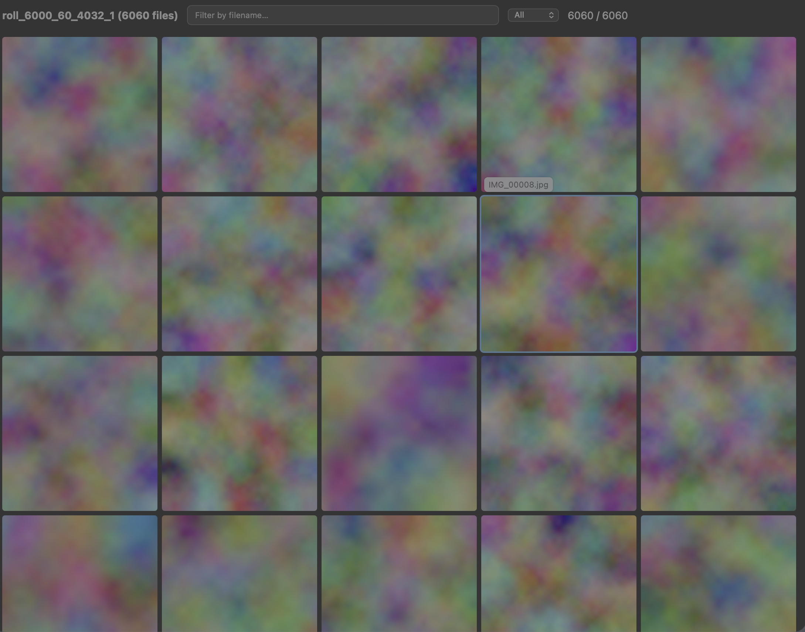

# Fast Visual Gallery

6k images + 60 videos generated randomly in 17s from fresh,

 .venv/bin/python stress_gallery.py scale && open "$TMPDIR/fvg_stress/apps/scale/gallery.html"

work dir: /var/folders/fk/4w7lpw7d6blfm4mtpj2m44340000gn/T/fvg_stress

== scale: 6000 images + 60 videos
  [PASS] cold run exits cleanly
  [PASS] all files found: 6060 / 6060
  [PASS] cold run under 60s: 15.9s, 382 files/s, peak RSS (tree) 6315 MB
  [PASS] nothing skipped: 0 skipped
  [PASS] warm run processes nothing: 0 to process
  [PASS] warm run under 2s: 0.16s
  [PASS] page lists every file: 6060 items
  [PASS] item names unique
  [PASS] every item has its generated files: 0 missing, e.g. []
  [INFO] thumbs/ footprint: 12969 files, 200 MB, 15.4 KB/file avg
  [INFO] page size: 7 KB HTML + 0.53 MB item list (all cells built at load)

9 passed, 0 failed in 17s
## Video keyframes

Open a video and its keyframes come up with it. Click a keyframe to jump there; the one playing is outlined.

- **Side by side**: when the video leaves room next to it, like a phone video on a desktop screen, the keyframes fill that space (or go underneath on a tall screen).
- **Map**: when the video fills the screen, the keyframes sit in a small map over its top-right corner.
- Press **K** to switch between auto / side / map / off. The page remembers your choice.

The keyframes come from [fast_mp4_grids](../fast_mp4_grids) (`mp4cut`), which decodes only keyframes, so each video takes well under a second whatever its length. Videos that don't have a map yet get one on the next run; the thumbnails stay cached.

    python gallery.py ~/Movies                      # uses ../fast_mp4_grids/bin/mp4cut.mjs
    python gallery.py ~/Movies --mp4cut /path/to/mp4cut.mjs   # or set $MP4CUT
    python gallery.py ~/Movies --no-keyframes

You need `node` 22.2 or newer. Without it or the repo, videos open as before.
